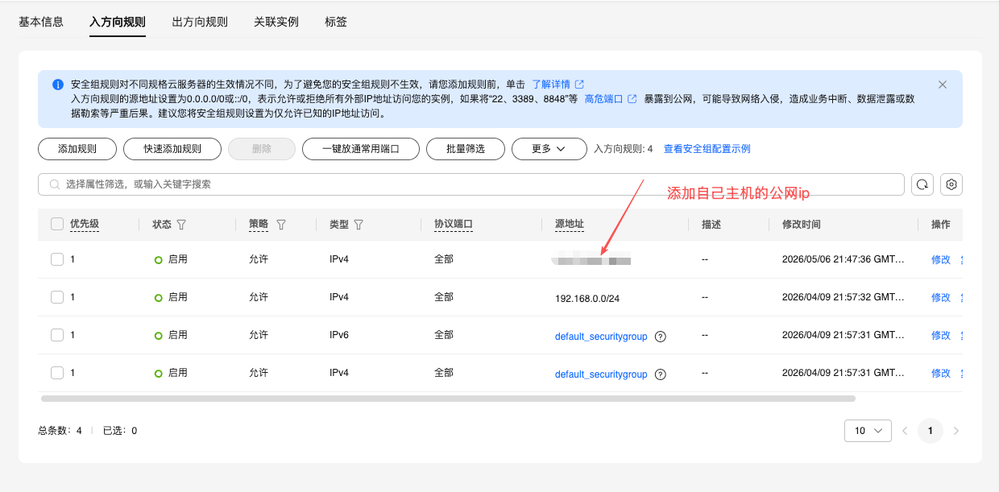
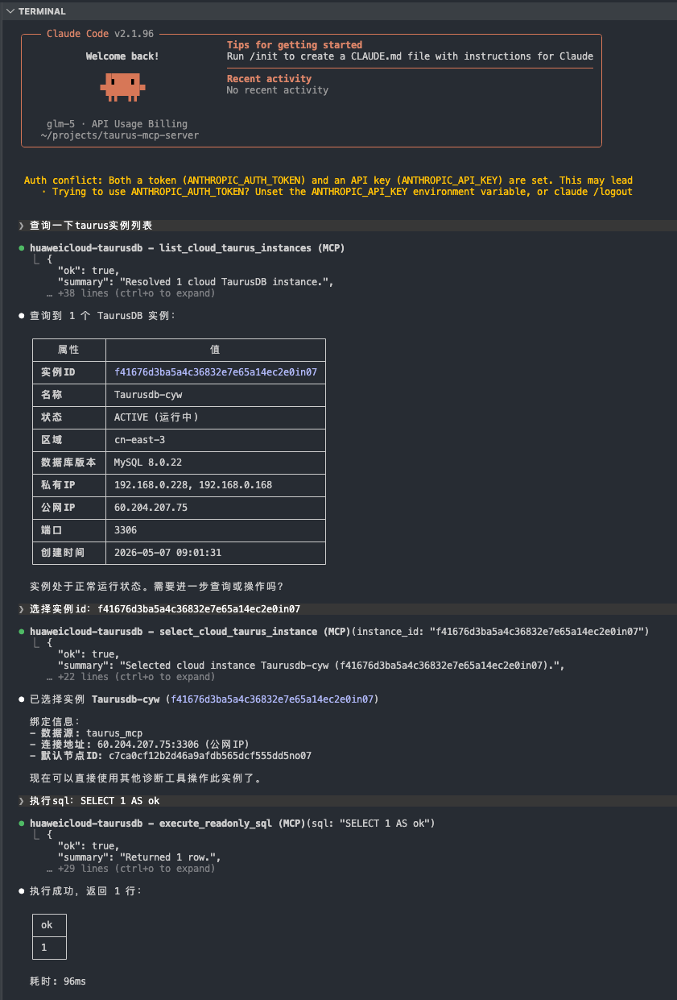
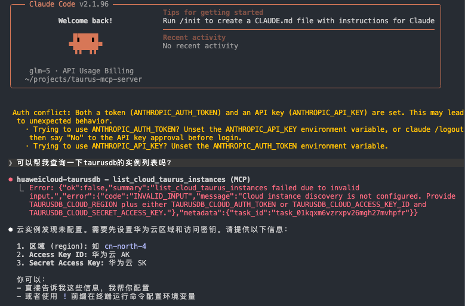
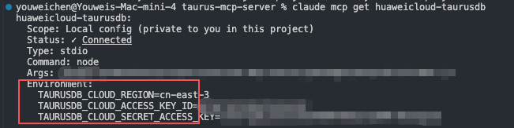

# TaurusDB MCP Server

[中文](README.md) | **English**

[](https://www.npmjs.com/package/taurusdb-mcp)
[](https://github.com/youweichen0208/taurus-mcp-server/actions/workflows/ci.yml)


Let your AI assistant (Claude, Cursor, VS Code Copilot, Codex, and others) **inspect, diagnose, and tune
Huawei Cloud TaurusDB databases** in plain language, while making sure the AI **cannot change your data**.

> For example, just ask: "List my TaurusDB instances on Huawei Cloud", "Which SQL statements in this database
> are the slowest?", or "How many rows would this UPDATE affect? Don't run it."

---

## Contents

- [What it is](#what-it-is)
- [What it can do](#what-it-can-do)
- [Safety boundary: what the AI can and cannot do](#safety-boundary-what-the-ai-can-and-cannot-do)
- [Before you start: checklist](#before-you-start-checklist)
- [Step-by-step installation](#step-by-step-installation)
- [Using it](#using-it)
- [Tool reference](#tool-reference)
- [Production configuration](#production-configuration)
- [Troubleshooting](#troubleshooting)
- [More documentation](#more-documentation)

---

## What it is

**MCP (Model Context Protocol)** is an open standard that lets AI assistants call external tools. Once this
project is installed, your AI assistant gains a set of TaurusDB tools: it can list your instances on Huawei
Cloud, connect to a database, run readonly queries, analyze slow SQL, diagnose lock waits, and explain the
results to you in plain language.

The project is published on npm:

| Package | Purpose |
| --- | --- |
| [`taurusdb-mcp`](https://www.npmjs.com/package/taurusdb-mcp) | The MCP server. **This is the only package you install.** |
| [`taurusdb-core`](https://www.npmjs.com/package/taurusdb-core) | The internal engine, installed automatically. |

It runs **on your own computer**, started by your AI client when needed. There is no server to deploy.

---

## What it can do

| Scenario | You can say | Tools behind it |
| --- | --- | --- |
| Find and connect to an instance | "List my TaurusDB instances and select xxx" | `list_cloud_taurus_instances`, `select_cloud_taurus_instance` |
| Browse schemas | "Which databases are on this instance? What columns and indexes does orders have?" | `list_databases`, `list_tables`, `describe_table` |
| Readonly queries | "Count orders by status" | `execute_readonly_sql` |
| Execution plans | "Why is this SQL slow? Will it scan the whole table?" | `explain_sql`, `explain_sql_enhanced` |
| Assess a change before running it | "How many rows would this UPDATE affect? Any risks? Don't run it yet." | `analyze_mutation_sql` |
| Slow SQL | "What were the slowest statements in the last hour?" | `find_top_slow_sql`, `diagnose_slow_query` |
| Performance problems | "Our API got slow. Is the database the cause?" | `diagnose_service_latency`, `diagnose_db_hotspot` |
| Connections / locks / storage | "Connections spiked", "There are lock waits", "The disk is almost full" | `diagnose_connection_spike`, `diagnose_lock_contention`, `diagnose_storage_pressure` |
| Replication lag | "Why is the read replica lagging?" | `diagnose_replication_lag` |
| Historical data | "Show me this table as it was 10 minutes ago" | `flashback_query` (TaurusDB flashback query) |
| Recover a dropped table | "What's in the recycle bin? Restore xxx as orders_restored" | `list_recycle_bin`, `restore_recycle_bin_table` |
| Instance capabilities | "What kernel version is this? Which features are enabled?" | `get_kernel_info`, `list_taurus_features` |

See the full [tool reference](#tool-reference).

---

## Safety boundary: what the AI can and cannot do

This is the core of the design. Please take a minute to read it:

- ✅ **Can**: list instances, read schemas, run readonly SQL (SELECT / SHOW / EXPLAIN / DESCRIBE), and run diagnostics.
- ✅ **Can**: give SQL advice and an impact assessment for INSERT / UPDATE / DELETE / DDL you want to run.
  `analyze_mutation_sql` always marks its result `not_executed` and `human_review_required`; **you review it
  and run it yourself**, outside MCP.
- ❌ **Cannot**: run any SQL that changes data or structure. No matter how privileged the database account is
  or how it is configured, there is no switch that enables writes.
- ❌ **Cannot**: call user-defined functions or functions such as `SLEEP` and `GET_LOCK` that could lock, wait, or write.
- 🔐 **Your database password never passes through the AI**: you type it into a page in your own browser, which
  hands it directly to the MCP process on your computer. It never appears in the conversation and is not saved to disk.
- ♻️ **The only controlled exception is recycle-bin restore.** It can restore one **exactly named** recycle-bin
  table to a **new table that does not exist yet**, never overwrites an existing table, and is fully audited.
  Deployments that don't need it can turn it off (`TAURUSDB_ENABLE_RECYCLE_BIN_RESTORE=false`).
- 📝 **Everything is audited**: every tool call is written to a local audit log (by default only a hash of the SQL is recorded).

---

## Before you start: checklist

Check each item first; a missing one will make a later step fail:

| # | You need | Notes |
| --- | --- | --- |
| 1 | A computer | macOS, Windows, or Linux |
| 2 | **Node.js 20 or later** | See step 1 |
| 3 | An AI client that supports MCP | Claude Code, Claude Desktop, Cursor, VS Code (Copilot agent mode), or Codex |
| 4 | A **Huawei Cloud AK/SK** (access key) | See step 3; use an IAM user with read-only permissions |
| 5 | The instance's **region ID** | For example `cn-north-4` (CN North-Beijing4) or `cn-east-3` (CN East-Shanghai1) |
| 6 | A TaurusDB instance with a **public read/write address** | Your computer connects over the public network |
| 7 | The instance security group **allows your computer's public IP** | See step 5 |
| 8 | A database username and password | A **read-only account** is recommended |

---

## Step-by-step installation

### Step 1: Install Node.js

Download and install the **LTS version** (20 or later) from <https://nodejs.org/>. Then open a terminal
(Terminal on macOS, PowerShell on Windows) and run:

```bash
node -v
```

You should see `v20.x.x` or later.

### Step 2: Check that taurusdb-mcp runs

```bash
npx -y taurusdb-mcp@1.0.1 --version
```

The first run downloads the package, which takes a moment. Seeing `1.0.1` means everything works.

> 💡 Every command pins `taurusdb-mcp@1.0.1` so you always get the same version.
> When a new version is released, update the version in your commands and configuration (see the [changelog](CHANGELOG.md)).

### Step 3: Get your Huawei Cloud AK/SK and region

1. Sign in to the [Huawei Cloud console](https://console.huaweicloud.com/).
2. Click your username in the top-right corner → **My Credentials** → **Access Keys** → **Create Access Key**, and
   save the downloaded `credentials.csv` (it contains the Access Key ID and Secret Access Key).
3. Check the instance's region in the region selector at the top of the console and note its ID (for example `cn-north-4`).

> 🔒 Create a dedicated IAM user with read-only access to TaurusDB instances (use the read-only TaurusDB /
> GaussDB system policy shown in your console). Add read-only DAS and CES permissions if you want slow-SQL and
> monitoring diagnostics. Don't use your account's root AK/SK.

### Step 4: Store the AK/SK in your system credential store

**Don't** put the AK/SK in a configuration file. Run the command below and enter the Access Key ID and
Secret Access Key when prompted:

```bash
npx -y taurusdb-mcp@1.0.1 credentials configure
```

They are saved in your operating system's secure storage:

- **macOS**: Keychain (a system prompt appears)
- **Windows**: Credential Manager
- **Linux**: Secret Service; install `secret-tool` first (for example `sudo apt install libsecret-tools`)

> Using a temporary AK/SK? Add `--with-security-token` to store the security token as well.

Then check it (replace `cn-north-4` with your region):

**macOS / Linux:**

```bash
TAURUSDB_CLOUD_REGION=cn-north-4 \
TAURUSDB_CLOUD_KEYCHAIN_SERVICE=taurusdb-mcp/huaweicloud \
  npx -y taurusdb-mcp@1.0.1 credentials check
```

**Windows PowerShell:**

```powershell
$env:TAURUSDB_CLOUD_REGION="cn-north-4"
$env:TAURUSDB_CLOUD_KEYCHAIN_SERVICE="taurusdb-mcp/huaweicloud"
npx -y taurusdb-mcp@1.0.1 credentials check
```

The check never prints secrets and does not connect to the database.

### Step 5: Let your computer reach the database

MCP runs on your computer and connects to the instance through its **public address**:

1. In the TaurusDB console, open the instance → **Basic Information** and make sure a **public read/write
   address** is enabled (enable one if not).
2. Find your computer's current public IP:

   ```bash
   curl ifconfig.me
   ```

   On Windows you can also open <https://ifconfig.me> in a browser.
3. Open the instance's **security group** → **Inbound Rules** → **Add Rule**:
   - Protocol and port: TCP `3306` (or the instance's actual port)
   - Source: `your-public-ip/32`, for example `203.0.113.10/32`

   

> ⚠️ Never set the source to `0.0.0.0/0`. When your public IP changes (new network, reconnect), update the rule.
> For production or long-term use, running in a cloud server in the same VPC is preferable; see
> [Advanced configuration: connection options](docs/advanced-configuration.md#连接方式) (in Chinese).

### Step 6: Add MCP to your AI client

Follow the section for **the client you use**. In every example:

- replace `cn-north-4` with your region ID;
- keep `TAURUSDB_CLOUD_KEYCHAIN_SERVICE` as `taurusdb-mcp/huaweicloud` (matches step 4);
- you **don't** enter a database address, username, or password here; you sign in when you use it.

<details open>
<summary><b>Claude Code (CLI)</b></summary>

```bash
claude mcp add huaweicloud-taurusdb \
  --transport stdio \
  -s user \
  -e TAURUSDB_CLOUD_REGION=cn-north-4 \
  -e TAURUSDB_CLOUD_KEYCHAIN_SERVICE=taurusdb-mcp/huaweicloud \
  -- npx -y taurusdb-mcp@1.0.1
```

Check it:

```bash
claude mcp get huaweicloud-taurusdb
```

Seeing `command`, `args`, and `env` means it's configured. `-s user` makes it available in every project;
use `-s local` to limit it to the current directory.

</details>

<details>
<summary><b>Claude Desktop</b></summary>

1. Open Claude Desktop → **Settings** → **Developer** → **Edit Config** to open `claude_desktop_config.json`:
   - macOS: `~/Library/Application Support/Claude/claude_desktop_config.json`
   - Windows: `%APPDATA%\Claude\claude_desktop_config.json`
2. Add the following (if the file already has other `mcpServers`, add just the `huaweicloud-taurusdb` entry):

```json
{
  "mcpServers": {
    "huaweicloud-taurusdb": {
      "command": "npx",
      "args": ["-y", "taurusdb-mcp@1.0.1"],
      "env": {
        "TAURUSDB_CLOUD_REGION": "cn-north-4",
        "TAURUSDB_CLOUD_KEYCHAIN_SERVICE": "taurusdb-mcp/huaweicloud"
      }
    }
  }
}
```

3. **Quit Claude Desktop completely** and reopen it. When `huaweicloud-taurusdb` appears under the tools icon
   in the message box, it's working.

</details>

<details>
<summary><b>Cursor</b></summary>

1. Create or edit `~/.cursor/mcp.json` (`%USERPROFILE%\.cursor\mcp.json` on Windows), or open it from
   Cursor **Settings → MCP → Add new MCP server**.
2. Add:

```json
{
  "mcpServers": {
    "huaweicloud-taurusdb": {
      "command": "npx",
      "args": ["-y", "taurusdb-mcp@1.0.1"],
      "env": {
        "TAURUSDB_CLOUD_REGION": "cn-north-4",
        "TAURUSDB_CLOUD_KEYCHAIN_SERVICE": "taurusdb-mcp/huaweicloud"
      }
    }
  }
}
```

3. Restart Cursor. `huaweicloud-taurusdb` should show as green in **Settings → MCP**. Use it in **Agent** mode.

</details>

<details>
<summary><b>VS Code (GitHub Copilot agent mode)</b></summary>

1. Open the Command Palette (`Cmd/Ctrl + Shift + P`) → **MCP: Open User Configuration** to open your user `mcp.json`.
2. Add:

```json
{
  "servers": {
    "huaweicloud-taurusdb": {
      "type": "stdio",
      "command": "npx",
      "args": ["-y", "taurusdb-mcp@1.0.1"],
      "env": {
        "TAURUSDB_CLOUD_REGION": "cn-north-4",
        "TAURUSDB_CLOUD_KEYCHAIN_SERVICE": "taurusdb-mcp/huaweicloud"
      }
    }
  }
}
```

3. Save, click **Start** above the entry, and switch Copilot Chat to **Agent** mode.

</details>

<details>
<summary><b>Codex</b></summary>

```bash
codex mcp add huaweicloud-taurusdb \
  --env TAURUSDB_CLOUD_REGION=cn-north-4 \
  --env TAURUSDB_CLOUD_KEYCHAIN_SERVICE=taurusdb-mcp/huaweicloud \
  -- npx -y taurusdb-mcp@1.0.1
```

Or edit `~/.codex/config.toml` directly (shared by the CLI and IDE extension):

```toml
[mcp_servers.huaweicloud-taurusdb]
command = "npx"
args = ["-y", "taurusdb-mcp@1.0.1"]
enabled = true

[mcp_servers.huaweicloud-taurusdb.env]
TAURUSDB_CLOUD_REGION = "cn-north-4"
TAURUSDB_CLOUD_KEYCHAIN_SERVICE = "taurusdb-mcp/huaweicloud"
```

Check it: `codex mcp list`.

</details>

> 💡 Shortcut: `npx -y taurusdb-mcp@1.0.1 init --client claude` (or `cursor`, `vscode`) writes a basic
> configuration for you, but **without** the `env` above. Add the two environment variables afterwards.

### Step 7 (optional): Run a self-check

Run the acceptance command in a terminal to confirm installation and configuration:

```bash
TAURUSDB_CLOUD_REGION=cn-north-4 \
TAURUSDB_CLOUD_KEYCHAIN_SERVICE=taurusdb-mcp/huaweicloud \
  npx -y taurusdb-mcp@1.0.1 acceptance --instance-id <your-instance-id> --report acceptance.json
```

It prints a local login link in the terminal; open it in your browser and sign in to the database, and the
check continues. `[pass]` means passed, `[pending]` means not configured or not run (neither a pass nor a
failure), and `[fail]` means failed. See [TaurusDB cloud acceptance](docs/cloud-taurusdb-testing.md) (in Chinese)
for all options.

---

## Using it

Once configured, just talk to your AI client **in plain language**; it picks the right tools.

### First connection in four messages

1. **"List my TaurusDB instances"**
   The AI calls `list_cloud_taurus_instances` and lists instances in the current region.
2. **"Select instance `<instance-id>`"**
   The AI calls `select_cloud_taurus_instance` and returns a local login link
   (like `http://127.0.0.1:xxxxx/sql-login/...`).
3. **Open the link in your browser and enter your database username and password.** When you see
   "Account validated", go back to the conversation.
   - The page is in Chinese by default; use **English** in the top-right corner to switch;
   - the link is valid for **5 minutes**, works once, and allows up to 3 attempts;
   - your password goes only to the local MCP and **never** appears in the conversation;
   - the login is cleared after 30 idle minutes or 8 hours in total; just select the instance again.
4. **"List all databases and set the default database to `<name>`"**, then start asking questions.

This is what it looks like in Claude Code:



### Example prompts

```text
What columns and indexes does the orders table have?
Count orders per day for the last 7 days
Why is this SQL slow: SELECT * FROM orders WHERE user_id = 123 ORDER BY created_at DESC
Assess this UPDATE without running it: UPDATE orders SET status = 'closed' WHERE created_at < '2026-01-01'
What were the 10 slowest statements in the last hour? Suggest optimizations
Are there lock waits right now? Who is blocking whom?
Connections suddenly increased. What's the cause?
Disk usage is growing fast. Which tables are the largest?
Show the row with id = 100 in orders as it was 10 minutes ago
Which dropped tables are in the recycle bin?
```

### Requests to change data

If you ask the AI to run UPDATE / DELETE / ALTER and similar statements, it **won't run them**. It returns:

- `advised_sql`: the SQL to run (only when the table structure, conditions, and scope have been verified)
- an impact assessment: matched rows, execution plan, whether a full table scan is likely
- risks and business rules that need human confirmation

Review it, then run it yourself through your own database client or change process.

### Restoring a dropped table

With TaurusDB's recycle bin enabled, dropped tables are kept in the recycle bin. You can say:

```text
Which tables are in the recycle bin?
Restore <recycle-bin object name> from the recycle bin into the app database as a new table named orders_restored
```

The AI calls `restore_recycle_bin_table`: it confirms the recycle-bin object exists and the destination table
does not, then restores and verifies it. **This writes to the database**, so double-check the object and
table names. The signed-in database account needs permission to restore from the recycle bin.

---

## Tool reference

<details>
<summary>Show all tools (30)</summary>

**Instances and connection**

| Tool | Purpose |
| --- | --- |
| `list_cloud_taurus_instances` | List TaurusDB instances in the current region |
| `select_cloud_taurus_instance` | Select an instance and return a local database login link |
| `begin_sql_login` | Create a new local database login link |
| `get_session_binding` | Show the bound instance, database, and login state |
| `set_default_database` | Set the session's default database |
| `set_cloud_region` | Switch the Huawei Cloud region |
| `clear_sql_credentials` | Clear the database login for this session |
| `list_data_sources` | List configured datasources |
| `ping` | Check that the MCP server is running |

**Browsing and querying (readonly)**

| Tool | Purpose |
| --- | --- |
| `list_databases` / `list_tables` / `describe_table` | Databases, tables, columns, and indexes |
| `execute_readonly_sql` | Run readonly SQL (SELECT / SHOW / EXPLAIN / DESCRIBE) |
| `explain_sql` | Execution plan and risk hints |
| `explain_sql_enhanced` | TaurusDB enhanced plan analysis |
| `show_processlist` | Current sessions and running SQL |
| `analyze_mutation_sql` | Advice and impact assessment for a change, **not executed** |

**TaurusDB features**

| Tool | Purpose |
| --- | --- |
| `get_kernel_info` / `list_taurus_features` | Kernel version and feature switches |
| `flashback_query` | Flashback query: a table's data at a past point in time |
| `list_recycle_bin` | Tables in the recycle bin |
| `restore_recycle_bin_table` | Restore one exactly named recycle-bin object as a new table (the only write; can be disabled) |

**Diagnostics**

| Tool | Purpose |
| --- | --- |
| `find_top_slow_sql` | Slowest / most expensive SQL |
| `diagnose_slow_query` | Why a single statement is slow |
| `diagnose_service_latency` | Classify the bottleneck behind "the API is slow" |
| `diagnose_db_hotspot` | Database hotspots |
| `diagnose_connection_spike` | Connection spikes |
| `diagnose_lock_contention` | Lock waits and blocking chains |
| `diagnose_replication_lag` | Replication lag |
| `diagnose_storage_pressure` | Storage and temporary-table pressure |

If the instance doesn't support a TaurusDB feature (or it's disabled), the tool returns a clear "unsupported"
error with how to enable it, rather than failing silently.

</details>

---

## Production configuration

For personal use, the steps above are enough. Before using it in production or across a team, review these defaults:

| Default | Notes | Recommendation for production |
| --- | --- | --- |
| Database connection **without TLS** | For direct connections to public IPs | Set `TAURUSDB_REQUIRE_TLS=true` with a trusted CA and certificate verification |
| Recycle-bin restore **enabled** | No separate approval step | Set `TAURUSDB_ENABLE_RECYCLE_BIN_RESTORE=false` if you need independent approval |
| Audit log on the local machine | File mode `0600`; only SQL hashes by default | Set a log path and ship it to central collection |

Recommended production environment variables (add them to the `env` of your MCP client configuration):

```bash
TAURUSDB_REQUIRE_TLS=true
TAURUSDB_MCP_AUDIT_LOG_PATH=/var/log/taurusdb-mcp/audit.jsonl
TAURUSDB_MCP_AUDIT_INCLUDE_RAW_SQL=false
TAURUSDB_MCP_AUDIT_MAX_BYTES=104857600
TAURUSDB_MCP_AUDIT_MAX_FILES=10
TAURUSDB_MCP_MAX_CONCURRENT_QUERIES=8
TAURUSDB_MCP_MAX_QUEUED_QUERIES=32
TAURUSDB_MCP_QUEUE_TIMEOUT_MS=5000
TAURUSDB_MCP_MAX_RESULT_BYTES=1048576
TAURUSDB_MCP_MAX_BLOB_BYTES=65536
TAURUSDB_SQL_CREDENTIAL_IDLE_TTL_MINUTES=30
TAURUSDB_SQL_CREDENTIAL_MAX_TTL_MINUTES=480
```

<details>
<summary>All safety mechanisms</summary>

- INSERT, UPDATE, DELETE, DDL, DCL, and administrative statements only produce SQL advice
  (`analyze_mutation_sql`); the result is always `not_executed` and `human_review_required`, and must be
  reviewed and run by you outside MCP. There is no setting that enables general writes.
- Queries are bound to the selected datasource/database; cross-database SQL is blocked.
- SQL may only call an allowlist of side-effect-free built-in functions; user-defined functions,
  schema-qualified functions, `GET_LOCK`, `SLEEP`, and similar are blocked (`R010`). The `COUNT`/`EXPLAIN`
  that `analyze_mutation_sql` derives follows the same rule, and refusals are explained in
  `impact_analysis.evidence_gaps`.
- Readonly queries and EXPLAIN of queries run inside `START TRANSACTION READ ONLY` as a database-side
  safeguard. MySQL rejects EXPLAIN of DML inside a read-only transaction, so DML EXPLAIN runs outside it; it
  never executes the DML itself.
- Local login links are bound to the instance, address, and region they were issued for; switching instance or
  region, clearing the login, or issuing a new link invalidates old links.
- Recycle-bin restore is the only controlled exception: `restore_recycle_bin_table` requires an unexpired local
  login session on the selected instance (configured static accounts get `SQL_SESSION_REQUIRED`) and restores
  one exactly named recycle-bin object to a destination table that does not exist. The audit target is fixed
  before the restore, and the request, completion, failure, and unverified outcomes all record the same
  instance, object, destination, and SQL hash. If the request cannot be audited, the restore does not start; if
  the final state cannot be confirmed, it returns `RECOVERY_STATE_UNCERTAIN`, so check the database before
  retrying. Only native restore is supported, and existing tables are never overwritten.
- Cloud APIs are restricted to HTTPS and Huawei Cloud domains.
- Queries are bounded by timeout, concurrency, queueing, rows, columns, field length, BLOB size, and total response bytes.

Deployment boundaries, central audit collection, and capacity budgets are described in
[customer deployment](docs/customer-deployment.md) (in Chinese).

</details>

---

## Troubleshooting

<details>
<summary><b>The AI can't find the TaurusDB tools / MCP didn't start</b></summary>

- After changing the configuration, **fully restart** the AI client (quit Claude Desktop from the menu bar or tray).
- Make sure `node -v` is 20 or later and `npx -y taurusdb-mcp@1.0.1 --version` prints a version.
- On **Windows**, if the client can't start `npx`, change the configuration to:

  ```json
  "command": "cmd",
  "args": ["/c", "npx", "-y", "taurusdb-mcp@1.0.1"]
  ```

- In Claude Code, run `claude mcp get huaweicloud-taurusdb` to inspect the configuration.

</details>

<details>
<summary><b><code>list_cloud_taurus_instances</code> returns <code>INVALID_INPUT</code> or says the region/credentials are missing</b></summary>



The MCP process didn't receive the region or credentials:

- Check that the MCP configuration contains `TAURUSDB_CLOUD_REGION` and `TAURUSDB_CLOUD_KEYCHAIN_SERVICE`.
  Running `export` in another terminal does **not** reach the MCP process your AI client starts.
- Make sure `credentials check` from step 4 passes.
- Restart the client after changing the configuration.

When it's configured correctly, `claude mcp get huaweicloud-taurusdb` shows the `env` entries:



</details>

<details>
<summary><b><code>401 verify ak sk signature failed</code></b></summary>

- The AK/SK is wrong, disabled, or deleted: run `credentials configure` again.
- You use a temporary AK/SK but didn't store the security token: run it again with `--with-security-token`.

</details>

<details>
<summary><b><code>DB_ENDPOINT_UNREACHABLE</code> or no public address when selecting an instance</b></summary>

- The instance has no public read/write address: enable one in the console.
- The security group doesn't allow your current public IP, or your IP changed: run `curl ifconfig.me` again
  and update the inbound rule (step 5).
- Your company network, VPN, or local firewall blocks outbound port 3306.
- `DB_CONNECTION_REFUSED`: the address is reachable but the port refused the connection; check the instance status and port.

</details>

<details>
<summary><b>The login page says the link has expired</b></summary>

Links are valid for 5 minutes and work once; switching instance or region, or clearing the login, also
invalidates old links. Ask the AI to "create a new database login link" (`begin_sql_login`) or select the
instance again.

</details>

<details>
<summary><b>Account validation failed / attempt limit reached</b></summary>

- Check the database username and password (this is the **database** account, not your Huawei Cloud login).
- After 3 failed attempts the link is invalidated; create a new one.
- The page shows a specific error code (such as `DB_AUTH_FAILED` or `DB_VALIDATION_TIMEOUT`) and what to do.

</details>

<details>
<summary><b>Asked to sign in again after a while / <code>SQL_SESSION_REQUIRED</code></b></summary>

Database logins are cleared after 30 idle minutes or 8 hours in total, by design. Select the instance and sign
in again. Recycle-bin restore requires a session signed in through the local page; configured static accounts
cannot restore.

</details>

<details>
<summary><b>A feature is reported as unsupported (<code>UNSUPPORTED_FEATURE</code>)</b></summary>

The instance kernel is too old or the feature is disabled (for example the recycle bin or flashback query). The
error message gives the required version and the parameter to enable; enable it in the TaurusDB console's
parameter settings and try again.

</details>

<details>
<summary><b><code>credentials configure</code> fails on Linux</b></summary>

You need `secret-tool` and a running Secret Service (desktop environments usually provide one):

```bash
sudo apt install libsecret-tools   # Debian / Ubuntu
sudo dnf install libsecret         # Fedora / RHEL
```

On headless servers, use container secret injection or another method described in
[advanced configuration](docs/advanced-configuration.md) (in Chinese).

</details>

---

## More documentation

Most detailed documentation is in Chinese.

| Document | Contents |
| --- | --- |
| [Advanced configuration](docs/advanced-configuration.md) | Unattended deployment, DEW CSMS / KMS-managed database passwords, private network access, session model |
| [Customer deployment](docs/customer-deployment.md) | Deployment model, least privilege, audit collection |
| [TaurusDB cloud acceptance](docs/cloud-taurusdb-testing.md) | Post-install acceptance steps |
| [Architecture](docs/architecture.md) | Internal design |
| [Development and releases](docs/development.md) | Building from source, testing, and releasing (maintainers) |
| [Release readiness](docs/release-readiness.md) | Release criteria and process (English) |
| [Changelog](CHANGELOG.md) | Version history (English) |

Questions and suggestions: [GitHub Issues](https://github.com/youweichen0208/taurus-mcp-server/issues)

## License

[MIT](LICENSE)
