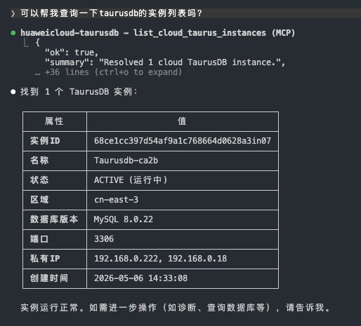

# 开发与发布

本文面向本仓库的维护者：从源码构建、本地测试、接入本地构建的 MCP，以及 npm 发布流程。
使用者请看 [README](../README.md)。

## 本地开发

如果你要开发当前仓库，再使用下面的本地流程。

安装依赖：

```bash
npm install
```

开发模式启动当前 MCP Server：

```bash
npm run dev
```

构建：

```bash
npm run build
```

运行测试：

```bash
npm test
```

只看 MCP 包的检查 / 测试：

```bash
npm run check --workspace taurusdb-mcp
npm run test --workspace taurusdb-mcp
```

查看本地 workspace 版本：

```bash
npx taurusdb-mcp --version
```

## npm 发布

维护者先在本地执行完整发布检查：

```bash
npm run release:check
```

日常开发合入默认分支 `develop`。发布时从 `develop` 拉出 `release/<主版本>.<次版本>`
分支（如 `release/1.0`），CI 通过后在该分支上创建 `v<version>` tag；同一版本线的
补丁先合入 `develop`，再 cherry-pick 到发布分支。release workflow 会拒绝不在对应
发布分支上的 tag。GitHub release workflow 会重新执行门禁、生成 SBOM，并按
`taurusdb-core` → `taurusdb-mcp` 的顺序使用 npm provenance 发布。不要从开发机
手工执行 `npm publish`。

发布配置和回滚要求见 [发布就绪门禁](release-readiness.md)。

安装和运行已发布包：

```bash
npm install taurusdb-mcp
npx taurusdb-mcp --version
```

## 从源码配置 Claude Code

下面是从本地源码构建并接入 Claude Code 的开发路径。普通用户优先使用上面的 npm 配置。

### 1. 构建

```bash
cd /path/to/taurus-mcp-server
npm run build
```

### 2. 添加本地 MCP Server

如果你只想先验证本地 MCP 能否启动：

```bash
claude mcp add huaweicloud-taurusdb \
  --transport stdio \
  -- node "$(pwd)/packages/mcp/dist/index.js"
```

如果希望 Claude Code 带着云控制面配置启动，先用 `credentials configure`
保存身份，再只传入非敏感配置：

```bash
claude mcp add huaweicloud-taurusdb \
  --transport stdio \
  -e TAURUSDB_CLOUD_REGION=<your-region> \
  -e TAURUSDB_CLOUD_KEYCHAIN_SERVICE=taurusdb-mcp/huaweicloud \
  -- node "$(pwd)/packages/mcp/dist/index.js"
```

如果使用临时凭证，在 `credentials configure` 的安全输入流程中同时保存
Security Token。

### 3. 验证 MCP 注册

```bash
claude mcp list
claude mcp get huaweicloud-taurusdb
```

检查重点：

- `huaweicloud-taurusdb` 已出现在 `claude mcp list`
- `claude mcp get huaweicloud-taurusdb` 能看到正确的 `command`
- 如果你通过 `-e` 写入了云配置，`env` 不应为空

### 4. 验证云控制面

在 Claude Code 里直接调用：

- `list_cloud_taurus_instances`

查询成功时，通常会看到类似下面这样的结果：



说明当前 MCP 会话已经能使用这组凭证访问华为云控制面，并且能看见实例列表。

### 5. 验证数据库数据面

控制面通过后，实例选择会直接创建本机数据库登录链接：

1. `select_cloud_taurus_instance`
2. 浏览器打开返回的 `login_url`，输入数据库账号和密码并完成连接验证
3. `list_databases`
4. `set_default_database`
5. `get_session_binding`
6. `execute_readonly_sql` with `SELECT 1 AS ok`

如果 `SELECT 1` 成功，说明数据库数据面也已连通。
